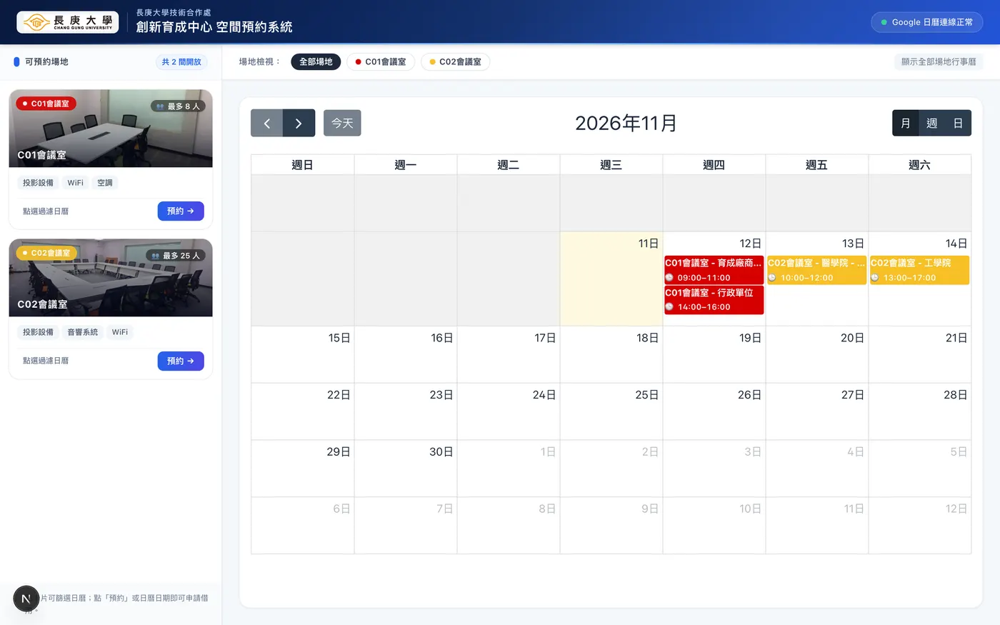
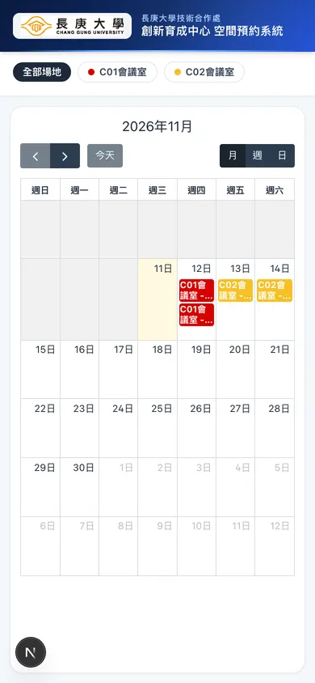

# 長庚大學創新育成中心空間預約系統

以 Next.js（Pages Router）開發的空間預約系統，直接以 Google Calendar 作為預約資料的單一來源：使用者在前台選時段即時確認可用性，送出後直接寫入官方日曆，管理員在 `/admin` 調整場地、表單欄位與事件顯示設定。

## 畫面預覽

| 桌機 | 手機 |
| --- | --- |
|  |  |

## 功能特點

- 即時查看各場地可用狀態（FullCalendar 月／週／日檢視）
- 線上預約、送出前後各做一次衝堂檢查，避免重複預約
- Google Calendar 整合（服務帳戶，時區固定 Asia/Taipei）
- **自助取消**：預約成功後取得 30 天有效的簽章連結，可自行取消（寄件信箱也會收到同一條連結）
- **通知信**：預約成功與取消時寄信給申請人（Resend 或自訂 Webhook，選填）
- 後台管理頁面（`/admin`，HTTP Basic Auth）：場地開關、名稱／圖片覆寫、表單欄位必填、事件過濾與配色、日曆連線診斷
- **後台預約管理**：日期區間／關鍵字／場地篩選、CSV 匯出（Excel 相容）、單筆取消
- 響應式版面：桌機左右分割、手機單欄
- Vercel 部署（Vercel KV 儲存後台設定）

## 環境變數

| 變數 | 必填 | 說明 |
| --- | --- | --- |
| `GOOGLE_CREDENTIALS` | ✅ | Google 服務帳戶 JSON（單行） |
| `CALENDAR_ID` | ✅ | 要寫入的 Google Calendar ID |
| `ADMIN_USERNAME` / `ADMIN_PASSWORD` | ✅ | `/admin` 的 Basic Auth 帳密；未設定時後台直接回 500 拒絕 |
| `KV_REST_API_URL` / `KV_REST_API_TOKEN` | 建議 | Vercel KV：保存後台設定、分散式鎖與**跨實例限流**；未設定時本機改寫入 `src/config/app-config.json`，限流退回單實例記憶體 |
| `BOOKING_TOKEN_SECRET` | 建議 | 取消預約連結的 HMAC 簽章金鑰（≥16 字元）。未設定時以 `GOOGLE_CREDENTIALS` 推導（輪替憑證會使舊取消連結失效） |
| `RESEND_API_KEY` / `MAIL_WEBHOOK_URL` / `MAIL_FROM` | 選填 | 預約／取消通知信。設定 Resend 或自訂 Webhook 其一即可；未設定時不寄信，預約流程完全不受影響 |
| `NEXT_PUBLIC_SITE_URL` | 選填 | 取消連結使用的站台網址（缺少 forwarded header 時的後備） |
| `CRON_SECRET` | 建議 | 每日備份 Cron 的授權金鑰；未設定時 `/api/cron/backup` 一律拒絕（fail-closed） |
| `MAIL_TEST_TO` | 選填 | `POST /api/admin/mail-test` 未指定收件者時的預設測試信箱 |

本機開發：`cp .env.local.example .env.local` 後填入上述值。

## 指令

```bash
npm ci              # 安裝依賴（依 package-lock.json）
npm run dev         # 開發模式
npm run build       # 生產建置
npm start           # 啟動生產伺服器
npm run lint        # ESLint
npm run typecheck   # TypeScript 型別檢查
npm run test        # vitest 單元測試
npm run test:e2e    # Playwright 端對端測試（會自動 build 並啟動 production server）
npm run test:integration  # 真實 Google Calendar / Upstash 整合測試（會載入 .env.local）
npx -y @lhci/cli@0.14 autorun   # Lighthouse 效能量測（需先 npm run build，預設量測 :3000）
```

## 專案結構

```
src/
  components/BookingForm.tsx    預約表單（含即時可用性檢查）
  components/Calendar.tsx       FullCalendar 包裝（事件內容以 textContent 組出）
  pages/index.tsx               前台首頁
  pages/admin.tsx               後台設定
  pages/api/submit-booking.ts   建立預約（驗證 → 鎖 → 查核 → 寫入 → 衝突驗證 → 回滾）
  pages/api/check-availability.ts 時段可用性查詢（10 秒快取）
  pages/api/calendar-events.ts  公開事件列表（只回脫敏欄位）
  utils/configSchema.ts         設定型別／正規化／停用場地換算（client-safe）
  utils/appConfig.ts            設定讀寫（Vercel KV 或本地 JSON，server-only）
  utils/bookingRules.ts         營業時間、時長、日期驗證（前後端共用）
  utils/availabilityUtils.ts    場地識別與衝堂判斷
  utils/googleCalendarService.ts Google API、JWT 快取、KV 分散式鎖
  utils/sanitize.ts             輸入清理與 HTML escape
  utils/rateLimit.ts            公開端點限流
tests/                          vitest 單元測試
```

## 設計上的重要約定

1. **事件內容一律用 DOM／textContent 產生**，不可使用 FullCalendar 的 `html` 字串，避免使用者輸入被當成 HTML 執行。
2. **場地識別以結構化標記為準**：寫入時在 description 加上 `[SPACE:<id>]` 與 `extendedProperties.private.spaceId`；舊事件才退回標題／地點關鍵字比對，且不採計「用途」等自由文字欄位。
3. **停用場地只認 id**：名稱形式的舊資料在 `resolveDisabledSpaceIds()` 統一換算成 id，前後端共用同一份判斷。
4. **公開 API 不回傳個資**：`/api/calendar-events` 只回 `id/title/start/end/color/location/applicant/spaceId`，`applicant` 由伺服器擷取並清理，完整 description（含電話、Email）不對外。
5. **預約寫入失敗要能回滾**：insert 之後任何步驟失敗都會嘗試刪除剛建立的事件，避免留下孤兒事件把時段卡死。
6. **設定讀取失敗不得靜默改變行為**：`readAppConfigMeta()` 會回報 `degraded`，`DEFAULT_APP_CONFIG` 不包含任何停用場地。
7. **預約時間粒度為 30 分鐘**（`BOOKING_RULES.slotMinutes`），最短 30 分鐘、最長 4 小時；時間選項、日曆 `slotDuration` 與後端驗證共用同一組常數。
8. **取消預約用無狀態簽章**：token 為 `base64url(payload).hmac`，內含 eventId／spaceId／到期時間；伺服器不存資料，`BOOKING_TOKEN_SECRET` 即撤銷金鑰。
9. **CSP 採 nonce 式**：`src/middleware.ts` 為每個文件請求產生 nonce，`_document.tsx` 從回應標頭取出並套到 Next 的腳本；因此**所有頁面都必須是 SSR**（`getServerSideProps`）。`404`／`500` 是 Next 的靜態頁，無法取得 nonce，其腳本會被 CSP 擋下（頁面仍可正常顯示靜態內容）。
10. **限流優先走 KV**：`consumeRateLimit()` 在設定 KV 時用 `INCR` 做跨實例固定視窗；KV 故障才退回單實例記憶體。
11. **場地圖片一律用 webp**：原始 jpg 已轉檔並移除（總大小 1.4MB → 180KB），`spaces.ts` 內另附 16px 的 `blurDataURL` 作為載入前的模糊預覽；新增圖片請比照辦理，並在 `next.config.js` 的 `images.formats` 下由優化器輸出 avif/webp。

## 維運端點

| 端點 | 認證 | 用途 |
| --- | --- | --- |
| `GET /api/healthz` | 公開 | 健康檢查：實際讀一次日曆，回 `ok / configSource / configDegraded / calendar / eventCount / latencyMs / checkedAt`；正常 200、異常 503、每 IP 每分鐘 20 次 |
| `GET /api/cron/backup` | `Authorization: Bearer <CRON_SECRET>` | 每日備份：把近 62 天預約存成 CSV 到 KV（`backup:latest`、`backup:index`）；由 `vercel.json` 的 Cron 於台北時間 02:00 觸發 |
| `GET /api/admin/backups` | Basic Auth | 列出備份索引；`?download=latest` 或 `?download=YYYY-MM-DD` 下載 CSV |
| `GET/POST /api/admin/mail-test` | Basic Auth | 寄信設定自我測試（`POST { "to": "..." }` 會實際寄一封） |
| `GET /api/admin/bookings` | Basic Auth | 預約列表／CSV 匯出／取消 |
| `GET /api/admin/reports` | Basic Auth | 使用率報表（場地使用率、熱門時段、星期與月份分佈） |
| `GET /api/admin/calendar-health?strict=1` | Basic Auth | 憑證與日曆診斷（異常回 503，適合接監控） |

### 監控與備份的開通方式

1. **監控**：`.github/workflows/uptime.yml` 每 30 分鐘打一次 `/api/healthz`，失敗會讓 workflow 失敗並由 GitHub 通知 repo owner（不需額外設定 secrets）。也可改用 UptimeRobot 等外部服務監控同一支端點。
2. **備份**：在 Vercel 設定 `CRON_SECRET`（隨機字串）後，`vercel.json` 的 Cron 會自動帶 `Authorization: Bearer <CRON_SECRET>` 呼叫。Vercel Hobby 方案每日一次，實際觸發時間可能有約 1 小時誤差。
3. **通知信**：到 [Resend](https://resend.com) 取得 API key，設定 `RESEND_API_KEY` 與已驗證網域的 `MAIL_FROM`（或改用 `MAIL_WEBHOOK_URL`），重新部署後用 `POST /api/admin/mail-test` 驗證。

## 測試與 CI

- `tests/` 覆蓋可用性判斷、預約規則（日期合法性、營業時間、時長）、設定正規化、輸入清理與限流。
- `.github/workflows/ci.yml` 在 push / PR 時依序執行 lint → typecheck → test → build，再跑一輪 Playwright E2E。
- E2E 涵蓋：首頁與日曆載入、預約對話框開啟／Esc 關閉、必填欄位阻擋送出、時段選項範圍、公開 API 不洩漏個資與內部錯誤、手機版版面無水平溢出。
- `.github/workflows/lighthouse.yml` 另外跑 Lighthouse CI（3 次取中位數）：performance ≥0.93、accessibility ≥0.93、best-practices ≥0.92、SEO ≥0.90、LCP ≤4s、CLS ≤0.1。CI 沒有 Google 憑證，`/api/calendar-events` 會回 500 並顯示浮動錯誤提示，best-practices 門檻已據此設定。
- `e2e/booking-submit.spec.ts` 以 `page.route()` 攔截 `check-availability` / `submit-booking`，在不需真實 Google 憑證的情況下驗證完整送單流程（成功、409 衝突、503 無法確認、容量超限），並斷言送出內容包含 `spaceId` 且不含 `colorId`。

## 部署（Vercel）

1. 匯入 GitHub repo，設定上方環境變數。
2. 建立 Vercel KV 並連結專案（未連結時後台設定無法保存）。
3. 部署後用 `/api/admin/calendar-health?strict=1` 確認憑證與日曆連線（健康時 200，異常時 503，適合接 uptime 監控）。

## 安全性須知

- 服務帳戶金鑰**只能**存在於環境變數或 `.env.local`，`.gitignore` 已擋掉常見檔名。
- 若不慎將金鑰提交進版本控制：**先到 Google Cloud 停用／刪除該金鑰並建立新的**，再清理 git 歷史。歷史清理無法撤銷已經被公開複製的金鑰。
- 若要把此 repo 轉為公開，請先確認 `git log --all -- '*.json'` 不含任何憑證內容。
